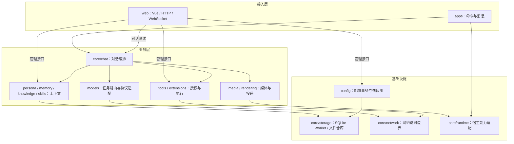
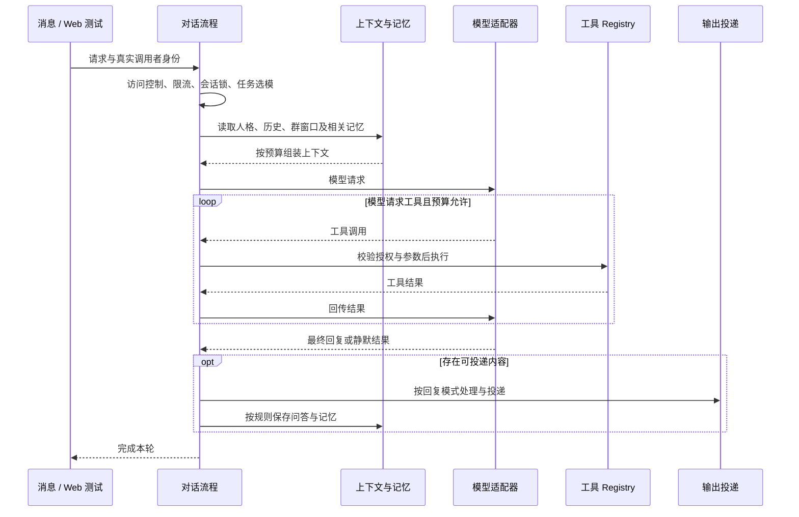

# 架构与数据流

## 运行与模块

`index.js` 接入 Yunzai，加载构建产物 `output/runtime/`。业务源码使用 TypeScript，宿主能力统一经 `hostRuntime` 访问。命令前缀由 `core/message/command-prefixes.ts` 定义，默认 `#yui`；第一人称呼叫独立配置。

### 模块边界



图中只列主要依赖。配置为各业务模块提供只读快照；业务代码通过 `hostRuntime` 使用宿主能力。用户 URL 读取走安全网络客户端，供应商显式配置地址走超时客户端。Skill 参与上下文组装，可执行工具统一经 Registry；两者不混用。

| 模块 | 职责 |
| --- | --- |
| `apps/` | 命令解析、权限检查与回复；普通入口和主人入口分开注册 |
| `core/chat/` | 会话、上下文预算、工具循环和输出流程 |
| `core/message/`、`core/persona/`、`core/media/` | 消息引用、人格提示和媒体准备 |
| `core/rendering/` | 图片渲染、引擎选择与投递 |
| `models/` | 任务选模、供应商协议与调用观测 |
| `tools/`、`extensions/`、`filters/`、`skills/` | 工具注册执行、用户扩展、消息过滤和提示词能力 |
| `memory/`、`knowledge/` | 长期记忆、知识检索和机器人指令知识 |
| `config/`、`core/storage/` | 配置事务、SQLite 与文件持久化 |
| `web/` | 管理台、鉴权 API 和 WebSocket |

## 对话与上下文



模型配置分为 `apiProviders → models → modelTasks`，分别管理供应商、模型能力和任务选模。工具权限与执行流程由各协议共用。流式响应在适配器内聚合，再交给工具循环和输出流程。

同一渠道可以挂载不同用途的模型：渠道提供地址和鉴权，模型独立选择实际请求协议，不能因渠道使用对话协议而覆盖模型协议。导入、编辑、列表诊断和单模型测试使用同一映射：

| 模型用途 | 模型协议 | 请求接口 |
| --- | --- | --- |
| 嵌入模型 | `embeddings` | `POST /embeddings`；Gemini 原生嵌入保留 `batchEmbedContents` 传输 |
| 重排序 | `rerank` | `POST /rerank` |
| 决策判断 | `systemone` | `POST /systemone`，兼容 TypeSafe System One |

专用模型不参与对话、工具调用或流式回复。旧的内置嵌入、重排和 TypeSafe 决策配置加载后按用途转换为上述协议，保留模型 ID、渠道地址和鉴权；用途与协议不匹配的直接配置校验失败。嵌入协议配置改变会更新模型配置指纹，已有不兼容向量索引需管理员显式重建；期间保留关键词召回，升级不自动请求模型重建。


渠道重命名时同步模型的 `apiProvider` 引用，模型内部键和任务路由保持稳定。测试结果、普通运行日志及管理台日志统一展示渠道、上游模型名与协议；内部模型键仅用于配置引用、筛选和关联。日志统计与路由详情优先使用调用时记录的名称，模型改名或删除后不使用新配置改写历史。

群聊每轮按以下顺序组装请求：

1. **System**：人格与运行规则构成稳定前缀，Skill、记忆和知识按需补充。
2. **个人主线**：按渠道、群和请求者隔离的问答历史。
3. **当前消息**：真实请求者、群窗口、引用与附件、时间、正文和实际可用图片。

群窗口按消息 ID、作者和回复关系去重，保留时间顺序；与个人历史重复的内容不再次注入，超出预算时优先保留点名或引用相关的完整回复链。窗口资料不改变请求者身份，也不写入个人历史；话题承接结合引用、语义与参与关系判断。结束对话清除个人历史和协议状态，保留群窗口、记忆与知识库。

图片指代依据真实提及、唯一昵称或引用定位；“我发的”绑定请求者，“你发的”绑定助手，对象不明时澄清。成功投递的图片凭宿主真实消息 ID 登记；多 ID 回执须核对群、作者和图片内容，共用一秒核验预算，失败不猜测回执也不影响已成功投递。后续按需从平台读取原图；视觉输入准备失败不以缩略图替代，缩略图仅供日志展示。无视觉需求不下载群图片。

群聊新回合重建本地上下文，同轮工具回传可以续接 Responses ID。各协议共用有界本地裁剪，Responses 同时支持请求内服务端压缩及一次明确错误兜底，详见 [Responses 与上下文压缩](responses-api.md)。

图片模式和长文本转图只渲染过滤、引用处理后的回复正文，不附加用户身份、渠道或诊断。自动转图属于投递阶段；模型主动排版使用 `render_image`，创作图片使用 `generate_image`。格式与权限见 [内置工具](builtin-tools.md#统一图片渲染)。

## 配置与存储

| 数据 | 位置 |
| --- | --- |
| 默认配置 | `config/defaults.ts` |
| SQLite 启动参数、可选 Web Token | `config/config.json` |
| 运行配置、会话、记忆、知识、任务与审计 | `data/yui-chat/storage/state.sqlite3` |
| 可重建向量索引 | `data/yui-chat/storage/vectors.sqlite3` |
| Custom Tool、Filter、Skill | `data/yui-chat/extensions/` |
| 手动配置包 | `data/yui-chat/backups/` |
| 安装任务、事件、收据、加密凭据 | `state.sqlite3` 的 `extension_*` 表 |
| 安装凭据本地主密钥 | `data/yui-chat/installation-secrets/key`（目录 0700、文件 0600） |
| 未提交 / 待恢复安装材料 | `data/yui-chat/extensions/.install-work/`（加载器跳过） |
| 临时媒体和渲染文件 | 插件 `cache/` |

配置由单写队列提交：连接 SQLite、合并默认值、迁移与校验、写入启动项和运行覆盖，成功后发布冻结快照。`get()` 只读，修改通过 `update()`；SQLite 提交失败回滚启动 JSON，已使用 SQLite 主配置时不静默降级到默认值。

配置包只导出运行配置及白名单表，不含聊天、记忆、知识正文和日志；仅管理员显式操作创建。SQLite 表结构见 [数据库文档](sqlite-baseline-er.md)。测试用 `YUI_CHAT_RUNTIME_ROOT` 隔离数据，smoke 自动创建和清理测试目录。

## 记忆与知识

知识库采用 SQLite 双库：状态库持有正文、分块和 FTS5 全文索引，向量库通过 sqlite-vec 的 `vec0` 保存独立模型空间。关键词路径使用中文词语及双字片段的 FTS5/BM25 和子串补充，内置指令增加精确文本评分；模型通过知识库工具的每轮授权简要目录精确选库，完整用途和字段说明在选库查看或检索结果中按需提供；目录超出预算时通过 list 发现，默认搜索范围仍为全部授权库。选定库按上限并发，每库同时执行词法与 Cosine 向量召回，同模型复用查询向量；通过加权 RRF 汇总后，再按开关统一调用一次重排模型。关闭或失败保留融合结果；仅同指令冲突组按宿主顺序排序并折叠。数据库、索引关系、分片及评分公式见[知识库索引架构](command-knowledge.md#数据库与索引架构)与[索引与相似度算法](command-knowledge.md#索引与相似度算法)。

知识配置单独修改时仅发布查询所需的新快照；混合配置修改保持完整热应用。指令知识按需从宿主已加载规则目录采集（离线静态脚本作为备用），在外部整理后按永久 ID 导入 SQLite，`retrievalText` 是统一检索正文，采集初稿包含插件名称、标识与使用说明，priority、regexp 和 regexpFlags 只保存在元数据；库级字段说明独立保存，仅在重排与回答时按库提供一次，不参与分块或向量计算；列表按插件分组，启停状态独立于导入文档，控制知识检索与推荐而不改变宿主执行；导入、手动编辑、历史回退共用事务与审计，每条含当前最多保留三个版本。正文事务持久化文档增量向量及旧块清理任务，普通变更直接更新兼容空间，不复制整库。编辑边界、重启行为和验证范围见 [指令知识与 RAG](command-knowledge.md)。

个人记忆区分全局与本群作用域。普通召回以当前发言人为准，明确询问他人时才切换目标；召回内容标注来源。向量近邻在已确定的用户/群作用域和当前可召回记忆集合内选取，返回前再次检查状态与作用域，其他用户或已归档、过期记忆不占候选名额。群原文采集与记忆提炼分开，原文用于核对，不直接参与记忆召回。提炼按日期、预算和置信度处理，embedding 受独立预算约束。

日常注入按 `memory.retrieval.resultLimit` 返回融合、重排后的最相关记忆（默认 3 条，允许单群覆盖），并遵守 `promptTokenBudget`（默认 2,000 Token）。本地 FTS/BM25 负责全文召回；本轮存在记忆相关意图或显式搜索时，独立配置的向量模型同时进行语义召回，不再因为全文命中数量足够而跳过。两路按 RRF（常数 60）融合，重要性和活跃度仅用于同分排序；可选专用重排模型随后处理有界候选，超时或失败保留融合顺序。记忆的 `embeddingModel` 与 `rerankModel` 单独保存，不继承知识库 RAG 或全局任务；向量模型留空关闭语义路，开启重排必须明确选择专用模型。重排设有候选上限、输入预算、超时、缓存及可选最低分，不调用额外的日常提炼。

用户明确要求“查询我的全部记忆并总结”时，不按相关性筛选或自动注入条数截断，而是由既有 `memory_manage` 的 `list/all=true` 读取本人全局及当前群个人有效事实和提炼经历，包含低活跃记忆；不混入群公共记忆、其他成员、其他群个人记忆、原始问答、已归档/删除或过期记录。SQLite 全量读取不受普通列表 200 条上限影响，默认一并返回；只有本轮明确请求本人全量记忆且工具显式传入 `list/all=true` 才读取；普通 search 和不带 all 的 list 不自动升级，否定、他人归属和能力咨询保持普通路径。分页使用 `cursor/pageSize`，将 `nextCursor` 原样传入 cursor，游标绑定真实调用者作用域、资料版本和最后一条已读记忆；增删改或游标无效时返回空页、`restartRequired=true` 和 `complete=false`，从头读取，不能将变化前后的页面混为全量。工具提供总数、当前页数量、`nextCursor`、`complete` 与来源完整性。仍遵守所用对话模型的上下文和工具轮次预算：压缩时保留整条事实并按实际保留的最后一条记录更新续读游标，预算不足则明确停止，不伪造已读完标志，模型需续读或说明限制，不能将部分资料称为全量总结。文件后端继续有界读取，超出窗口或存在不可读记录时明确报告无法保证全量。

SQLite 记忆管理列表显示置信度、当前活跃度及关联来源条数；打开记忆详情可查看最近确认、半衰期、明确到期时间和预计下次状态变化。置信度是写入评估值，不是统计准确率，也不随时间直接递减；活跃度从最近确认时刻按半衰期衰减，影响召回状态。身份事实、画像及固定记忆不随时间衰减，个人本群记忆为 90 天，全局偏好与习惯为 180 天（同时识别稳定事实键和中英文标签），其他普通事实为 365 天。活跃度低于 70%、35%、15% 时依次进入待巩固、低活跃和归档；明确到期时间优先于衰减，归档不代表删除。

群聊提炼或强化记忆时，将来源消息关联到 `memory_evidence`，可从记忆详情或提炼结果中的“查看记忆与来源”按页查看说话人、时间、来源群及文字原文。详情接口自行鉴权并核对记忆作用域；原文读取同时核对来源群、消息标识和保留期限，不发起平台历史拉取或加载远程媒体。原文按采集策略清理后保留证据标识，页面显示不可用状态。手动记忆和平台资料不虚构消息证据，人工修改后的记忆仍保留原证据并提示二者可能不同。文件存储后端保持既有生命周期规则，未提供的衰减指标明确显示为未记录。

记忆空间与查询缓存共用知识库的模型配置指纹，包含实际上游模型、渠道与参数；同名模型换上游也不复用旧向量。配置变化后的写入或语义查询会安排去抖同步，受既有预算和熔断限制，索引未就绪时保留 FTS 召回；重启和升级不主动生成向量。同步期间模型配置变化时不写入过期输出，成功同步后回收旧记忆空间。度量约定和知识库索引升级见[指令知识与 RAG](command-knowledge.md#增量向量与分片)。

记忆快捷指令不调用模型。查看自己固定使用发送者身份；查看或管理他人只允许主人，以真实提及或 QQ 号定位。列表序号绑定调用者、目标与会话，并在修改前校验。

群采集设置复用统一表单字段，输入框下显示来源与说明；编辑自动形成单群覆盖，恢复默认继续跟随系统。长提炼提示词默认折叠，可展开编辑；画像默认类型单独保存，只有修改后才显示其保存动作。

### 月度聊天画像

聊天画像是按需生成的报告，独立于人工结构化画像和长期事实。仅开启记忆总开关、群采集总开关及本群采集的群可以生成、查看和补录；暂停后保留副本但停止开放。普通成员仅操作本人，主人命令及鉴权 Web 管理员可以查看他人或强制重提炼，群管理员不默认获得此权限。命令见 [README](../README.md#常用指令)。

`memory/portrait.ts` 统一维护取材、生成、额度、默认类型和副本校验。额度按群、用户、画像类型及北京时间自然月独立计算；每种类型本月成功生成后普通请求返回该类型最新有效副本，不读取平台历史、不调用模型。下月只在再次请求时生成，没有画像定时任务。SQLite 运行任务唯一索引与进程内合并按类型防止并发重复生成，不同类型可以并行；失败不计额度，管理员重提炼失败保留原副本。额度独立于各类型最多保留三个版本的报告，清理版本不能重置额度。

管理台「记忆管理 → 画像设置」维护全局默认类型、模型、输入输出预算和历史数量。内置综合画像、正画像、负画像、找对象和克隆人格，默认正画像；每个成员可切换类型，分别生成和查看。使用 [astrbot_plugin_portrayal 的内置提示词](https://github.com/Zhalslar/astrbot_plugin_portrayal/blob/main/builtin_prompts.yaml)原文，来源、采用版本与 MIT 许可证位于 `resources/portrait/`，随插件离线提供。提示词只读，不再提供言语风格、风格模板编辑或混合叠加。群采集设置和成员页允许管理员覆盖默认打开的类型，优先级为本群成员、本群、全局；不限制用户选择其他内置类型。修改默认类型不调用模型或重新生成副本。

克隆人格只强制要求模板正文，标题、摘要和分析段落可省略；提供的额外字段仍执行格式、来源和隐私检查。输出可复制的纯文本模板；Web 显示复制按钮，群命令在图片后返回模板正文，不自动应用到日常对话、切换人格或修改机器人资料。找对象给出一般匹配类型和行动建议，不实际匹配或联系群成员。共用资料与输出规则要求有证据并保护隐私；性别和婚恋取向只采用本人明确自述，未知就不推断。资料不足时缩短正文或省略无依据的维度，不用套话凑篇幅；缺失项记录在管理端资料说明中，正文只保留最终特征、具体表现和相处建议，不展示分析方法、自我评价或推理过程。每份报告保留生成时的内置任务提示词快照。

画像由 `010-memory-portraits.sql` 在既有 009 结构上直接创建最终表、按类型隔离的额度与任务索引，以及来源撤回触发器；不创建临时风格表或重建已有业务表。

生成结合人工画像、目标用户的有效全局/本群事实、同类型上一版完整结构化正文和人格模板（仅作变化核对）及最近 50–500 条目标成员有效发言，默认 200 条。引用上下文仅使用本群期限内原文，不作为被画像者的直接证据；其他用户的个人记忆与其他群的个人群记忆不参与。画像输入预算默认及最高 100000 Token，涵盖系统规则、任务、人工画像、记忆、上一版报告和聊天记录；输出默认及最高 10000 Token，推理型模型的思考也计入输出上限。这是本地估算预算，实际请求仍受所选模型的上下文与输出能力约束，资料较少时不会填满预算。输入按预算收敛，不截断单条消息；隐私过滤和预算可能使实际条数少于请求值，报告记录实际数量与时间范围。上一版报告不能作为新证据；新报告不写回人工画像或事实，也不把犀利文案自动注入日常聊天。

本地不足且允许补录时，复用 `group-capture.ts` 的宿主原生 `getChatHistory`、游标和去重能力；每次群扫描总数受 `historyBackfillMaxMessages` 限制，单页最多 200 条，单页读取 15 秒、整次生成 3 分钟内结束。画像补录遵守原文保留期限，不恢复期限外消息，不立即新建或标记历史提炼任务；所有历史补录均只归档原文，跳过当前昵称/群名片同步，实时消息继续维护当前身份；正常采集调度仍按既有游标处理消息。接口不支持或补录不足时使用现有资料，完全无有效资料时失败且不计额度。清理期间的迟到结果不得重新写回。

报告每段关联本次输入的事实、人工资料或原文标识，并区分明确资料与本群行为观察。修改、删除、撤回来源或事实过期会停用所有类型中依赖该来源的报告；原文自然到期清理可以保留已生成报告和来源标识，但不再展示原文。显式清空群原文会停用本群报告。本月额度已用而副本失效时，普通成员等待下月，管理员可重提炼。生成和图片投递前复核群准入与来源，避免在途任务发布已撤回的资料。

模型只返回结构化数据，`core/rendering/portrait-template.ts` 对文字转义并生成固定排版，管理台预览与 `render-service.ts` 的统一 HTML 外框共用内容；标题固定为“昵称 · 画像类型”，普通画像只呈现摘要、有效标签和正文，克隆人格只呈现可复制的模板正文。依据类别、条数、补录信息、不确定性及固定免责声明不进入成品，资料说明和来源在管理端“查看依据”中展示；返回显式思考/推理过程标记的内容校验失败，不消耗额度。投递经 `render-delivery.ts`。旧副本重新渲染即可采用新排版，已保存正文中的旧措辞须管理员重提炼后更新，不自动调用模型重写。查看副本和重新渲染不调用模型，图片沿用临时文件生命周期。管理台的预览使用无脚本 iframe；所有画像 API 自行鉴权，不使用 URL 凭证，响应不缓存。生成任务日志只保存操作标识和通用失败状态，不复制上游异常中的地址、鉴权或原文。

## 工具、动作与扩展

工具统一经过 Registry 的授权、参数校验、执行限制、去重与投递检查。工具调用和结果保持配对；失败后的重试遵循工具副作用策略。内置功能集中见 [内置工具](builtin-tools.md)，契约与开发方式见 [工具开发指南](tool-authoring-guide.md)。

内置只读网络/知识检索返回后，在剩余工具轮次预算内提供一次纠正查询机会；查错话题，或知识检索无结果、动作明显不符时可以纠正，保留核心对象与条件，相关结果直接投递。后续恢复强制投递，不扩大工具轮次上限。

模型单独调用 `message_send` 并完整投递文字正文后，若没有待完成动作或明确的续答要求，本轮直接结束；同轮原生搜索不会再要求模型重写已发送的正文。实际正文保留在会话历史和日志中，搜索来源仍单独转发。纯媒体、混合工具和部分失败继续按原有规则处理；需要最终收束时，该次请求关闭本地与 Responses 原生工具。

动作将现有工具或已声明的项目资源绑定为快捷指令，支持参数、回复模板、预览与测试。动作保存后独立控制启停和最低角色；预览不执行，实际运行及后台投递重新校验授权。模型上下文专用工具不能绑定动作，示例默认停用。

Custom Tool/Filter 读取宿主或跨插件资源必须声明 `frameworkResources`，见 [框架资源文档](custom-framework-resources.md)。Skill 只注入提示词，不注册为可执行工具。用户扩展与源码分开，更新插件不覆盖用户代码。

Custom 工具随扩展包启停：启用并成功加载后即可进入工具目录，无需加入 `tools.enabledTools`；停用后重新加载会移除该包工具。正式调用仍受工具总开关、角色权限、自定义工具策略和模型工具策略约束。

扩展安装使用 `extensions/installation/` 的来源适配、计划、SQLite Store 与独立调度，入口为模型工具、主人命令和 Web 安装记录。可信消息由宿主原始事件捕获，主人身份从宿主配置重新读取。任务先持久化再受理，不依赖模型回合；目标锁覆盖旧编辑入口，隔离恢复先于 Registry 初始化。Skill 先保护为停用再原子发布，仅静态刷新 Skill；MCP 导入保存停用与空开放名单，连接、发现、启用分别授权。配置通用编辑及恢复不能绕过受管理目标的启停、固定端点和网络授权入口。详见 [安装流程与验收边界](extension-installation.md)。

## 管理台与安全

管理台页面共用 `web/client/styles/tokens.css` 的颜色、圆角与动效，以及 `web/client/ui/` 的分段导航、搜索框和弹窗组件。简短设置使用居中对话框，正文详情使用侧栏；编辑草稿沿用统一 dirty scope 与 `confirmAction()` 关闭保护。动效遵循系统减少动态效果偏好，导航与弹窗支持键盘操作。

管理台默认挂载 `/yui-chat`，API 和 WebSocket 自行鉴权。主人通过 `#yui面板` 获取一次性登录链接；浏览器使用 HttpOnly、SameSite=Strict 会话，修改请求校验同源。管理 Token 不进入 URL、浏览器存储或日志；一次性登录码与长期 Token 分开处理。

用户 URL 和媒体读取统一经过安全网络边界，逐跳校验地址、DNS、超时及大小。私网访问和截图域名由 `security.linkSafety` 控制，截图保留全请求拦截。子代理、主动问候和 URL 截图各自受独立开关约束；HTML 与 Markdown 等内容渲染统一跟随 render_image 工具权限。

模型日志记录实际进入适配器的请求、用量及工具链，详情支持按来源或消息顺序核对上下文；凭证脱敏，正文与媒体快照有大小上限。普通工具执行不伪造模型调用，`<EMPTY>` 静默结果不写入历史或记忆。

## MCP

### 工具开放范围

管理台「AI 能力 → MCP 服务 → 工具开放配置」展示每个已连接服务发现的原始工具名、说明与开放状态，修改后立即保存并重新加载。未连接或连接失败时会明确显示状态；名单中暂未发现的工具仍可移除。运行时短暂断线会保留最近一次发现的工具定义和开放状态，只把工具标为“当前异常”并记录连接阶段与错误详情，不会因为一次失败而撤销注入。

`mcp.servers.<服务名>.allowedTools` 使用服务的原始工具名：未配置或 `null` 表示全部开放（含未来新增工具），`[]` 表示全部关闭，`["search_images"]` 表示仅开放该工具。名单之外的工具不注册到运行目录，不参与模型注入、工具搜索或直接执行；已开放工具仍受角色、模型和网络权限限制。切换为名单模式后，服务新增工具默认不开放。普通连接配置编辑保留既有名单。

已注入的 MCP 适配器在传输异常时仍留在统一 Tool Registry 中；后续触发会按服务去重地重新连接并重新发现工具。首次启动就连接失败时，名单或工具策略中已经给出名称的工具会先以“待恢复”适配器保留；全开放模式若首次发现失败且没有已知工具名，需要管理员重新加载 MCP 完成发现。工具列表、诊断和日常定格不会批量重连失联服务；只有实际调用某个工具时才按需恢复它所属的服务，同一服务的并发恢复合并执行，其他服务不受影响。恢复后在发送调用前按最新参数定义再次校验。只读工具在连接异常且有效重试策略为 `safe` 时最多安全重试一次；管理员配置（含按 action 覆盖）优先于服务端注解，禁止重试的策略不会被只读注解覆盖。重连后同步刷新参数、说明和执行策略，并再次检查是否允许重试；撤销或移除的工具不会重新挂回旧连接。写入或结果不确定的工具只返回异常，不自动重复副作用。明确关闭 MCP 总开关、服务开关或移除开放名单时，才会清理对应的运行工具和缓存。

管理台支持“保存并发现”以及已保存服务的“测试连接 / 发现工具”。探测使用临时 MCP 客户端完成初始化和分页 `tools/list`，返回工具清单后关闭连接，不改变运行中的客户端、不写入工具注册表，也不要求 MCP 总开关或服务启用开关处于开启状态。

通过安装计划导入的 MCP 是受管理服务：不支持全开放，仅接受明确审阅的工具及 schema 摘要；schema 变化后旧授权不再注册。其端点与传输固定，凭据和网络绑定变更需先停用，会清空工具开放名单。连接、SSE endpoint POST 和重连使用同一 scoped fetch，逐次读取现有绑定、校验真实 DNS/IP、端口与路径，并通过固定地址的直连 socket 连接。服务级 CA 保留正常证书与主机名校验，不读取环境代理。未授权的私网、元数据及保留地址拒绝连接。

### 鉴权与密钥注入

手动管理的 stdio 服务使用 `env` 传递子进程环境，SSE 和 Streamable HTTP 服务使用 `headers` 配置请求头。连接配置支持 `${env:变量名}` 占位符，例如：

```json
{
  "transport": "streamableHttp",
  "url": "https://example.com/mcp",
  "headers": {
    "Authorization": "Bearer ${env:IMG_TAG_API_KEY}"
  }
}
```

安装计划导入的服务只允许独立凭据引用，不接受上述 `env`、Header 或环境占位符。

`env` 是当前 MCP 服务的连接级变量，不会修改 Yunzai 主进程的 `process.env`；HTTP 请求头可以引用它，stdio 则会把它传给对应的子进程。未在服务 `env` 中配置的变量才回退读取启动 Yunzai 时的环境变量。配置文件和管理台接口会对请求头与密钥字段脱敏；缺少变量、无效 Header 名称或换行值会使连接测试失败，不会把密钥写入日志、运行状态或响应。SSE 会同时给初始连接和后续 POST 请求附加这些请求头。

## 权限与人物处罚

角色规则与用户例外由统一权限矩阵判定。四种角色独立配置，风险仅作标签；内置工具按 `tools/access/role-presets.ts` 默认开放，扩展及未列入表的能力默认仅主人可用。包/服务子工具继承所属角色规则，角色规则内部明确禁止优先。个人禁止优先于个人允许，个人允许覆盖角色禁止；启停、模型策略、MCP 开放名单、网络边界和工具内部身份检查始终独立生效。

「AI 能力」提供角色快捷授权；「使用权限」维护角色规则、用户例外和只读查询。角色快捷修改通过配置更新队列提交，用户例外保存在 SQLite `capability_rules`；角色草稿未保存时阻止单项快捷修改，保存失败恢复原选项，批量应用先确认范围。工具权限变化不影响已保存动作的独立授权。

人物处罚使用独立工具，只能处理当前普通发言者，禁止动作和子代理调用。处罚按机器人、会话与用户隔离，保存在 `data/yui-chat/persona-punishments.json`；先串行预留记录再执行，超时或未知结果保留待核实状态。不回复处罚在对话 preflight 前通过统一访问控制拦截。普通自助禁言、管理屏蔽与人物处罚分别处理，不可相互替代。

启停、时长、保护对象、自助操作和解除条件见 [内置工具与权限](builtin-tools.md#自助与群管权限)。

## 用量与诊断

请求前按文本与图片分别估算预算：图片 URL/Base64 不按文本长度计数；缺少尺寸与模型专用 tokenizer 时每张图片预留 2048 tokens。这是预算近似值，不是实际计费或严格上限。上游返回后，统一协议保留实际用量及已知标记，立即更新调用详情和运行累计，最终会话用量与日汇总沿用上游数值；仅对缺失项估算。上游报告的零值及独立总量同样保留。日志详情以绿色实线标注上游用量、橙色虚线标注本地估算，并保留请求前输入预算供比较。

调用详情的开发者诊断展示脱敏、限长的响应与 usage。Responses 流式调用保留合并后的响应对象，其他协议展示适配器保留的数据；不表示完整网络事件流。旧日志或未取得响应的失败调用可能没有响应正文。

## 维护

开发与验证约束见 [AGENTS.md](../AGENTS.md)，历史变更见 [更新记录](../CHANGELOG.md)。
