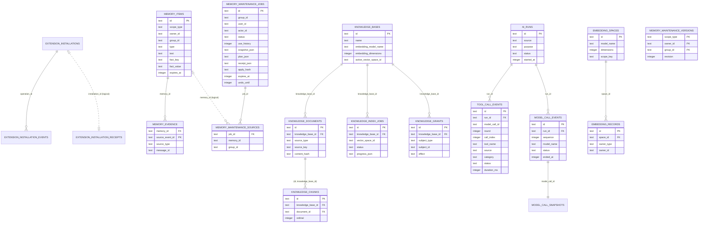
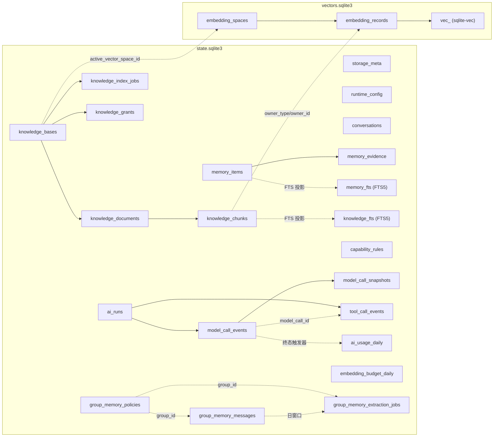

# SQLite 表结构

状态库位于 `data/yui-chat/storage/state.sqlite3`，向量库位于同目录的 `vectors.sqlite3`。迁移分别来自 `core/storage/sqlite/migrations/` 和 `core/storage/sqlite/vector-migrations/`，在 Worker 内事务执行；未知迁移或旧表会被拒绝并保留失败现场。

`ai_runs.session_id` 关联一段会话的顶层轮次，`conversation_key` 表示固定归属；运行、模型调用和工具事件的父级引用构成调用拓扑。模型快照独立存储上下文、工具定义与请求元数据，供详情页按需读取。

## ER 图

实线是数据库外键；虚线是同库内的投影或以业务键关联的关系（不以外键强制）。`memory_fts`、`knowledge_fts` 和每个 `vec_<space>` 均是可重建索引。

群策略的输入 Token 允许 3000–1000000，输出允许 256–100000；`013-memory-token-limits.sql` 扩大约束并保留原有策略字段、继承状态和采集游标。

## 全表清单

| 数据库 | 表 | 职责 | 关键列 |
| --- | --- | --- | --- |
| state | `storage_meta` | 存储元信息 | `key`, `value`, `updated_at` |
| state | `runtime_config` | 单行运行配置覆盖 | `id=1`, `schema_version`, `revision`, `overrides_json` |
| state | `conversations` | 临时对话历史 | `conversation_key`, `history_json`, `expires_at` |
| state | `memory_items` | 长期事实、画像、群提炼结果 | 作用域、正文、事实键值、状态、过期时间；`observed_at` 原始确认时间、`validity_reason` 状态原因、`superseded_by` 替代关系 |
| state | `memory_maintenance_jobs` | AI 整理分析、预览及有条件撤销 | 操作者、用户/群、历史开关、快照、单次建议、`reviewed_at` 结束审阅时间、提交回执与期限；同一用户跨群仅一条运行任务 |
| state | `memory_maintenance_sources` | 整理快照和结果的清理关联 | 任务外键、原件/结果记忆 ID、来源群；清理资料时移除恢复副本 |
| state | `memory_maintenance_versions` | 所有记忆/证据写入共用的版本 | 作用域/用户/群复合键及递增版本，供预览应用与撤销事务校验 |
| state | `portrait_type_defaults` | 本群/本群成员的默认画像类型 | 群、可空用户、内置类型 ID |
| state | `portrait_reports` | 各类型月度画像及最近三版本 | 群、用户、类型、版本、任务快照、结构化报告、来源哈希、失效状态 |
| state | `portrait_monthly_usage` | 独立月度成功额度 | 群、用户、类型、北京时间月份、报告 ID；与版本清理解耦 |
| state | `portrait_jobs` | 按需画像任务及管理员操作记录 | 操作者、强制重提炼、运行状态、通用错误；同群同用户同类型仅一条运行任务 |
| state | `group_memory_extraction_batches` | 每日提炼检查点 | 窗口外键、本批标识、消息版本、待应用候选和应用状态；成功后清除候选正文，清理窗口时级联删除 |
| state | `memory_extraction_budget_daily` | 后台提炼日预算 | 本地日期、已计入和在途预留 Token，保留 90 天 |
| state | `memory_evidence` | 记忆的最小证据引用 | `memory_id`, `source_event_id`, `source_type`, `message_id` |
| state | `memory_fts` | 记忆 FTS5 投影 | `memory_id`, `text` |
| state | `knowledge_bases` | 知识库设置与当前向量空间 | 模型、维度、检索设置、`active_vector_space_id` |
| state | `knowledge_documents` | 直接归属知识库的文档 | `source_type`, `source_key`, 标题、正文、哈希 |
| state | `knowledge_chunks` | 文档分块 | 文档/知识库复合外键、序号、正文、哈希 |
| state | `knowledge_fts` | 知识分块 FTS5 投影 | `chunk_id`, `knowledge_base_id`, 标题、正文 |
| state | `knowledge_index_jobs` | 向量重建任务与进度 | `vector_space_id`, 状态、尝试、`progress_json` |
| state | `knowledge_command_disabled` | 指令知识本地启停状态 | 来源、插件/指令类型、目标标识；独立于正文与向量 |
| state | `knowledge_vector_tasks` | 文档增量向量与旧块清理待办 | 文档/分块 ID、内容摘要、重试次数与错误 |
| state | `knowledge_document_history` | 指令文档旧版本 | 永久来源键、完整快照、操作和时间；当前存在时保留两版 |
| state | `knowledge_import_runs` | 导入及手动维护批次 | 来源、时间、新增/修改/删除/跳过数量 |
| state | `knowledge_import_changes` | 批次内的逐条变化 | 批次外键、永久 ID、操作、前后摘要 |
| state | `capability_rules` | 工具/能力授权规则 | 主体、资源、allow/deny |
| state | `knowledge_grants` | 知识库授权规则 | 知识库、主体、群域、allow/deny |
| state | `ai_runs` | 一轮模型工作的汇总 | `session_id`, `conversation_key`, `parent_run_id`, 来源、用途、作用域、用量、成本、状态 |
| state | `model_call_events` | 实际模型调用明细 | `run_id`, `parent_tool_id`, 序号、模型、用量、输入审计、错误 |
| state | `model_call_snapshots` | 模型请求详情快照 | `model_call_id`, 上下文 JSON、工具定义 JSON、含上下文来源分组的请求元数据、截断标记 |
| state | `tool_call_events` | 每次实际工具执行明细 | `run_id`, `model_call_id`, `parent_tool_id`, 轮次、工具、状态、耗时、参数与结果摘要 |
| state | `ai_usage_daily` | 日级模型用量汇总 | 日期、模型、用途、用量、调用数、成本 |
| state | `embedding_budget_daily` | Embedding 日预算账本 | 日期、模型、用途、预估 token、调用数 |
| state | `group_memory_policies` | 按群的采集策略 | `group_id`、继承覆盖、保留期、提炼设置与记忆召回条数 |
| state | `group_memory_messages` | 指定群的原始消息 | `group_id + message_id`、消息段、哈希、过期时间 |
| state | `group_memory_extraction_jobs` | 群消息自然日提炼任务 | `group_id`、窗口、进度、结果、重试状态 |
| vectors | `embedding_spaces` | 向量空间定义 | 模型、维度、距离度量、`scope_key` |
| vectors | `embedding_records` | 向量所有者元数据 | 空间、所有者类型/ID、内容哈希 |
| state | `extension_installations` | 安装任务与幂等状态 | 任务 JSON、版本、状态、幂等键 |
| state | `extension_installation_events` | 单调追加的安装事件 | 任务编号、序号、时间、脱敏事件 |
| state | `extension_installation_receipts` | 安装来源证明 | 固定来源、文件摘要、停用状态、退休时间 |
| state | `extension_credentials` | 独立凭据存储 | 加密内容或显式环境引用 |

安装任务的 CAS 更新与事件追加由 SQLite 触发器原子完成。任务和事件默认保留 90 天，活动收据长期保留，任务清理不级联删除收据；卸载退休旧收据后可重装同一 ID。配置包不包含安装表、凭据或本地主密钥。
